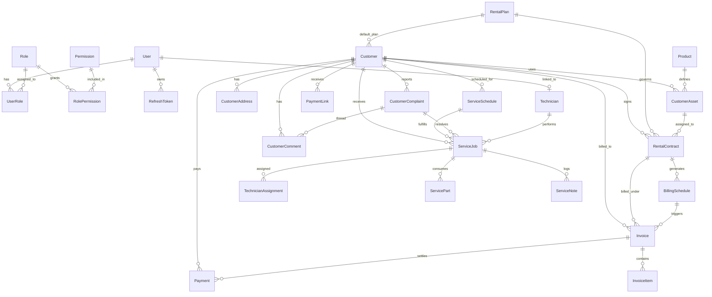

# Pure Home Waters — PostgreSQL Database Design

**ORM:** Prisma (`backend/prisma/schema.prisma`)  
**Database Engine:** PostgreSQL 15+  
**Primary Key Strategy:** UUID v4 (`@id @default(uuid()) @db.Uuid`)  
**Timestamp Strategy:** `TIMESTAMPTZ(6)` (`@db.Timestamptz(6)`) in UTC  
**Monetary Strategy:** `DECIMAL(12, 2)` (`@db.Decimal(12, 2)`) for all currency columns

---

## 1. Domain Architecture & Entity Relationship Overview

The PostgreSQL schema normalizes the legacy flat IndexedDB stores into **6 bounded domains** and **26 tables**:

---

## 2. Table Descriptions by Domain

### 2.1 Authentication & RBAC Domain

| Table (`@@map`) | Model | Description |
|---|---|---|
| `users` | `User` | Staff accounts (owners, accountants, support executives, technicians) with bcrypt password hashes and soft-delete (`deleted_at`). |
| `roles` | `Role` | System and custom RBAC roles (`OWNER_ADMIN`, `ACCOUNTANT`, `SUPPORT_EXECUTIVE`, `TECHNICIAN`). |
| `permissions` | `Permission` | Fine-grained permission codes (`customers.view`, `customers.create`, `payments.record`, etc.) grouped by module. |
| `user_roles` | `UserRole` | Many-to-many join between `users` and `roles` with composite unique constraint `(user_id, role_id)`. |
| `role_permissions` | `RolePermission` | Many-to-many join between `roles` and `permissions` with composite unique constraint `(role_id, permission_id)`. |
| `refresh_tokens` | `RefreshToken` | SHA-256 hashed refresh tokens supporting token rotation (`replaced_by_token`), revocation (`revoked_at`), and reuse detection. |

### 2.2 Customers Domain

| Table (`@@map`) | Model | Description |
|---|---|---|
| `customers` | `Customer` | Core customer identity, normalized 10-digit phone (`@unique`), unique `customer_code`, legacy ID mapping (`legacy_id`), rental summary fields, and archival flags (`is_archived`, `deleted_at`). |
| `customer_addresses` | `CustomerAddress` | Normalized installation and billing addresses per customer (`label`, `address_line_1`, `area`, `city`, `state`, `landmark`, `is_primary`). |
| `customer_complaints` | `CustomerComplaint` | Customer-reported purifier issues with `status` (`OPEN`, `IN_PROGRESS`, `RESOLVED`, `CLOSED`), `priority`, and resolution timestamp. |
| `customer_comments` | `CustomerComment` | Staff notes attached to either a customer profile or a specific complaint (`complaint_id`), attributed to `author_id`. |

### 2.3 Products & Rentals Domain

| Table (`@@map`) | Model | Description |
|---|---|---|
| `products` | `Product` | Water purifier catalog (`sku`, `name`, `model_name`, `default_unit_cost`, `maintenance_interval_days = 90`). |
| `customer_assets` | `CustomerAsset` | Physical purifier units deployed at customer locations (`serial_number`, `initial_investment`, `installed_at`, `status`). |
| `rental_plans` | `RentalPlan` | Subscription tiers (`Basic`, `Standard`, `Premium`) with `monthly_rent`, `deposit_amount`, JSON `features`, and `billing_cycle`. |
| `rental_contracts` | `RentalContract` | Active/historical rental agreements linking `Customer`, `RentalPlan`, and `CustomerAsset` with `billing_day` (1st) and `grace_period_days` (5 days). |
| `billing_schedules` | `BillingSchedule` | Scheduled billing periods per contract (`period_label`, `due_date`, `amount_due`, `status`), unique on `(rental_contract_id, period_label)`. |

### 2.4 Finance Domain

| Table (`@@map`) | Model | Description |
|---|---|---|
| `invoices` | `Invoice` | Formal monthly rental or service invoices (`invoice_number`, `for_month`, `subtotal_amount`, `tax_amount`, `total_amount`, `paid_amount`, `balance_amount`, `status`). |
| `invoice_items` | `InvoiceItem` | Line items belonging to an invoice (`description`, `quantity`, `unit_price`, `line_total`). |
| `payments` | `Payment` | Recorded rent or deposit collections (`amount`, `paid_date`, `for_month`, `receiver`, `payment_method`, `transaction_reference`, `is_historical_import`). |
| `payment_links` | `PaymentLink` | Generated payment links (`short_url`, `external_link_id`, `amount`, `status`, `paid_at`). |
| `payment_webhook_events` | `PaymentWebhookEvent` | Idempotent log of incoming payment gateway webhooks (`event_id @unique`, `signature`, `payload`, `processed`). |

### 2.5 Services Domain

| Table (`@@map`) | Model | Description |
|---|---|---|
| `technicians` | `Technician` | Field service technicians (`name`, `phone`, `is_default`, `is_active`, optional link to `users.id`). |
| `service_schedules` | `ServiceSchedule` | Planned 3-month preventive maintenance appointments (`scheduled_date`, `service_type`, `is_completed`). |
| `service_jobs` | `ServiceJob` | Executed or scheduled service visits (`service_type`, `service_date`, `next_service_date`, `technician_id`, `total_cost`, `status`). |
| `technician_assignments` | `TechnicianAssignment` | Assignment tracking between `service_jobs` and `technicians` (`assigned_at`, `completed_at`). |
| `service_parts` | `ServicePart` | Individual spare parts or filters replaced during a `ServiceJob` (`part_name`, `quantity`, `unit_cost`, `total_cost`). |
| `service_notes` | `ServiceNote` | Technician or support notes attached to a `ServiceJob`. |

### 2.6 Operations & Audit Domain

| Table (`@@map`) | Model | Description |
|---|---|---|
| `notifications` | `Notification` | In-app, SMS, email, or WhatsApp notifications queued for staff or customers. |
| `whatsapp_logs` | `WhatsAppLog` | Outbound WhatsApp reminder audit trail (`customer_id`, `phone`, `template_name`, `message_body`, `status`). |
| `automation_jobs` | `AutomationJob` | Registered BullMQ recurring job configurations (`job_key @unique`, `job_type`, `queue_name`, `cron_expression`, `is_enabled`). |
| `automation_logs` | `AutomationLog` | Idempotent job execution log (`idempotency_key @unique`, `attempt_number`, `status`, `error_message`). |
| `audit_logs` | `AuditLog` | Immutable security and operational audit trail (`actor_user_id`, `action`, `entity_type`, `entity_id`, `before_state`, `after_state`, `ip_address`). |
| `backup_logs` | `BackupLog` | Metadata log of SQL/JSON database backups and imports. |

---

## 3. Important Indexes & Unique Constraints

1. **Customer Lookup & Duplicate Prevention**:
   - `customers.phone` (`UNIQUE`), `customers.customer_code` (`UNIQUE`), `customers.legacy_id` (`UNIQUE`).
   - Indexes on `customers(name)`, `customers(area)`, `customers(status)`, `customers(next_due_date)`, `customers(deleted_at)`.
2. **Financial Integrity & Reconciliation**:
   - `invoices.invoice_number` (`UNIQUE`), `payments.transaction_reference` (`UNIQUE`), `payment_webhook_events.event_id` (`UNIQUE`).
   - Composite unique constraint on `billing_schedules(rental_contract_id, period_label)` to prevent duplicate monthly billing for the same contract and month.
   - Indexes on `payments(customer_id)`, `payments(paid_date)`, `payments(for_month)`, `payments(receiver)`.
3. **Service Scheduling & Dispatch**:
   - Indexes on `service_jobs(customer_id)`, `service_jobs(service_date)`, `service_jobs(next_service_date)`, `service_jobs(status)`.
   - Composite unique constraint on `technician_assignments(service_job_id, technician_id)`.
4. **Idempotent Background Jobs**:
   - `automation_jobs.job_key` (`UNIQUE`), `automation_logs.idempotency_key` (`UNIQUE`).

---

## 4. Foreign-Key & Data Integrity Rules

1. **`ON DELETE RESTRICT` on Financial & Operational History**:
   - `payments.customer_id`, `invoices.customer_id`, `rental_contracts.customer_id`, `billing_schedules.customer_id`, `service_jobs.customer_id`, `service_schedules.customer_id`, and `customer_complaints.customer_id` enforce `ON DELETE RESTRICT`.
   - Even at the database level, a customer with payments, invoices, contracts, or service history **cannot** be hard-deleted.
2. **Soft Deletion & Archival Policy**:
   - `DELETE /api/v1/customers/:id` performs a controlled archival (`is_archived = true`, `status = 'INACTIVE'`, `deleted_at = NOW()`), preserving all historical foreign-key relationships while excluding archived records from active operational lists.
3. **Legacy ID Preservation**:
   - `customers`, `rental_plans`, `payments`, `service_jobs`, `technicians`, `customer_complaints`, and `customer_comments` include `legacy_id INT UNIQUE` to guarantee 1-to-1 traceability during IndexedDB migration.
